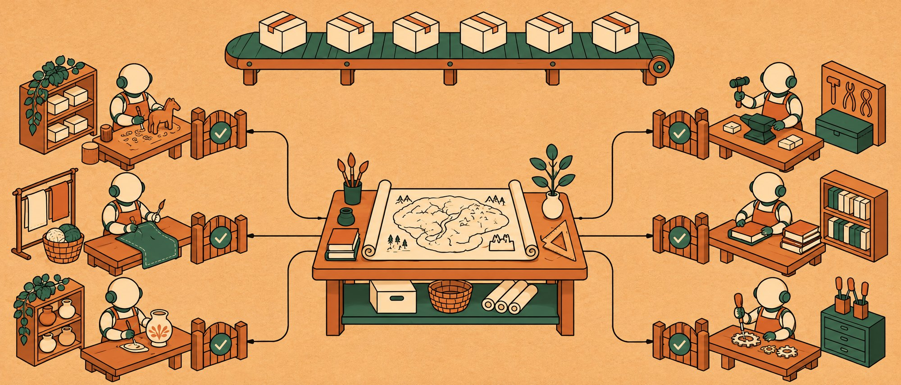
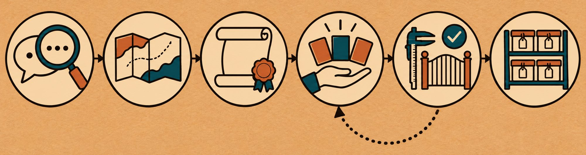
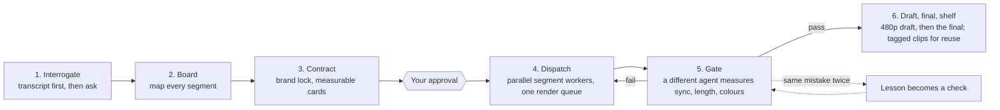

<p align="center">
  
</p>

<h1 align="center">atelier-video</h1>

<p align="center">
  <strong>Produce videos with Claude Code like a workshop, not a crowd.</strong><br>
  One lead turns your voice memo and a short request into a measurable contract, maps every segment,<br>
  dispatches parallel segment workers, renders through one queue, and lets nothing ship without an independent gate.
</p>

<p align="center">
  <a href="LICENSE"></a>
  <a href="https://github.com/erkandmrbas/atelier-video/actions/workflows/validate.yml"></a>
  
  
</p>

---

## Why

Asking an agent for "a nice explainer" gets you an average one. Asking four agents at once gets you four segments in four styles, captions that drift from the voice, a price on screen the speaker never said, and a full-resolution render of a cut you would have rejected in ten seconds.

atelier-video puts a workshop around Claude Code. The speed does not come from the agents. It comes from the order around them.

| Without atelier-video | With atelier-video |
| --- | --- |
| "Make it punchy" and hope | A contract with numbers: *8 to 10 visual changes per 10 s*, *captions within 1 frame of the voice*, *-14 LUFS* |
| Segments start before anyone has read the transcript | The transcript comes first, and every segment is mapped on a board before any work starts |
| Four segments, four looks | One brand lock: hex colours, typefaces, caption rules and a never-list every worker reads |
| "Done, it's in sync!" in chat | Done means a handoff note exists **and** a different agent measured the frame times and passed the gate |
| Captions drift, third time | The second time a mistake happens, it becomes a check that blocks every gate |
| Four workers fighting over one render machine | Renders, paid generations and the final mix each run through one queue |
| A full 1080p render of the wrong cut | A 480p draft first; the final renders only after your yes |
| Your feedback is forgotten next session | Every rejection is logged with its date and read before the next proposal |

## What it is for

- **Explainers** from a script or a voice recording, with screenshots, stills and a few generated clips.
- **Motion videos from a voice recording**: transcript first, then picture built to the words.
- **Screen-recording edits**: cut a long capture into a tight tutorial with zooms, callouts and chapters.
- **Short vertical clips**: 9:16 cuts from a longer talk or video, captions burned in.

atelier-video names no video, image or speech tool. Use the ones your project already has; the plugin supplies the method, the files and the gates.

## Install in 30 seconds

In Claude Code:

```text
/plugin marketplace add erkandmrbas/atelier-video
/plugin install atelier-video@atelier-video
```

From a shell: `claude plugin marketplace add erkandmrbas/atelier-video`, then `claude plugin install atelier-video@atelier-video`. Full details, local development and updates: [docs/install.md](docs/install.md).

Requires Python 3.9 or newer (standard library only).

## Use it

In a project folder with your recording and assets:

```text
/atelier-video:start turn the voice memo in input/ into a 90-second explainer for the website
```

The lead then works through the stations, and stops for your approval where it matters:

<p align="center">
  
</p>



## The 11 rules

1. **Interrogate first.** Turn the audio into text, read your notes and past rejections, then ask. Every question comes with a recommended answer, so you can reply "go with your recommendations".
2. **Map the whole video before any work.** Every segment, what must be on screen when the audio alone is not enough, what runs in parallel, and the shared bottlenecks (render, generation, mix).
3. **One lead.** You talk to one agent. It turns your short request into a contract and dispatches the segments.
4. **Four parts per task:** goal, constraints (what must never happen), a quality bar with numbers, examples (the brand lock, the transcript lines). Plus an approval checkpoint.
5. **Brief workers lightly.** Fixed decisions, the bar, and what is deliberately left open, such as the order of moves. Not a shot-by-shot recipe.
6. **State lives in files.** The lead writes the cards; a worker writes a handoff note. No handoff note, not finished. Any session can resume from the files after a crash.
7. **Gates at every exit.** One agent edits a segment, a different agent measures it. A segment that fails the sync gate never reaches assembly.
8. **The same mistake twice goes into code,** not into a note. Caption drift twice becomes a check that blocks every gate.
9. **Low-res draft first,** full-resolution final after approval. Tag every clip; reuse from the shelf before generating anything new.
10. **Parallelism is limited.** Default 4 segment workers. Renders, paid generations and the mix go through one queue each.
11. **You have the final word.** Rejections are logged with dates. No transcript and no report is trusted blindly.

The reasoning behind each rule: [docs/method.md](docs/method.md).

## What is inside

| Part | What it does |
| --- | --- |
| **9 skills** | `start`, `interrogate`, `board`, `contract`, `dispatch`, `gate`, `draft-first`, `lessons`, and `profile-video`, which `start` always loads: transcript first, listen-only test, brand lock, video quality bars, queues, lesson tags |
| **3 subagents** | `atelier-video:worker` builds one segment card, `atelier-video:reviewer` measures and writes the gate report, `atelier-video:researcher` looks before anyone builds |
| **`atelier.py`** | A dependency-free CLI that enforces the rules: card checks, handoff checks, gates, lessons, rejections, shelf |
| **3 hooks** | A worker cannot stop without a handoff note; the lead cannot stop with a task marked done that did not pass its gate; every session starts with the board and your past rejections |

Every project gets one folder of shared state, safe to commit:

```text
.atelier/
├── contract.md      the measurable contract (lead only)
├── board.md         every segment, its queue and what must be on screen (lead only)
├── tasks/T-01.md    task cards (lead only)
├── handoffs/T-01.md handoff notes (worker; none means not finished)
├── gates/T-01.md    gate reports (reviewer, never the worker)
├── checks/          automated checks born from repeated mistakes
├── lessons.md       every mistake, tagged and counted
├── rejections.md    what you did not like, with dates
├── shelf.md         approved clips, stills, transcripts and music beds, tagged for reuse
└── bin/atelier.py   the CLI, copied in so every agent can run it
```

## The gate, in practice

worker-2 cut the 15-second hook segment of an explainer, wrote its handoff note, then tried to sign off its own work with `result: pass`. The card names `reviewer-1` as the reviewer. Real output, trimmed:

```console
$ python3 .atelier/bin/atelier.py gate T-02
PASS card front matter id is T-02 (found 'T-02')
PASS card section 'Quality bar' is filled
PASS card quality bar holds at least one number
PASS handoff section 'Against the quality bar' is filled
FAIL reviewer 'worker-2' is not the handoff author (a different agent must review and write the gate report .atelier/gates/T-02.md)
FAIL reviewer 'worker-2' is not the card owner (a different agent must review and write the gate report .atelier/gates/T-02.md)
FAIL reviewer 'worker-2' is the one assigned on the card (reviewer-1); only that reviewer writes .atelier/gates/T-02.md
PASS the card's quality bar is unchanged since this review
PASS gate result is pass (found 'pass')
PASS no repeated lesson without a check
Gate T-02: FAIL. The work does not move on until every line passes.
```

The segment stays out of assembly until `reviewer-1` reads the frame times against the transcript and every line says `PASS`. And a pass does not last forever: if the card's quality bar or the handoff note changes after the review, the gate fails until the assigned reviewer measures again and writes a new report.

## Example

[A 90-second explainer from a voice recording](docs/example-video.md): transcript first, a price the transcript got wrong, a brand lock, six segments in parallel, a render queue, a sync gate that fails and then passes, a rejection, a 480p draft before the 1080p final.

## FAQ

**Does it make the video itself?** No. It runs the job: questions, plan, cards, workers, gates, drafts, shelf. The workers use whatever speech-to-text, editing, image and render tools your project already has.

**Is it overkill for one short clip?** Often. `start` has a fast path for small jobs (one worker, at most 1 output, no shared render) and tells you when to skip the method.

More: [docs/faq.md](docs/faq.md).

For software projects, see [atelier-software](https://github.com/erkandmrbas/atelier-software).

## Contributing

Issues and pull requests are welcome. This repo is built with its own method: see [CONTRIBUTING.md](CONTRIBUTING.md).

## License

[MIT](LICENSE)
